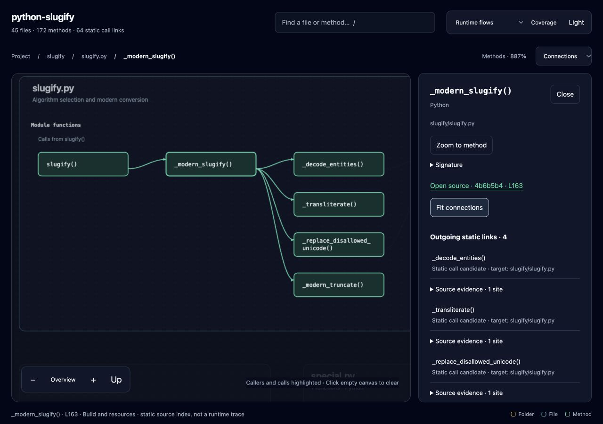
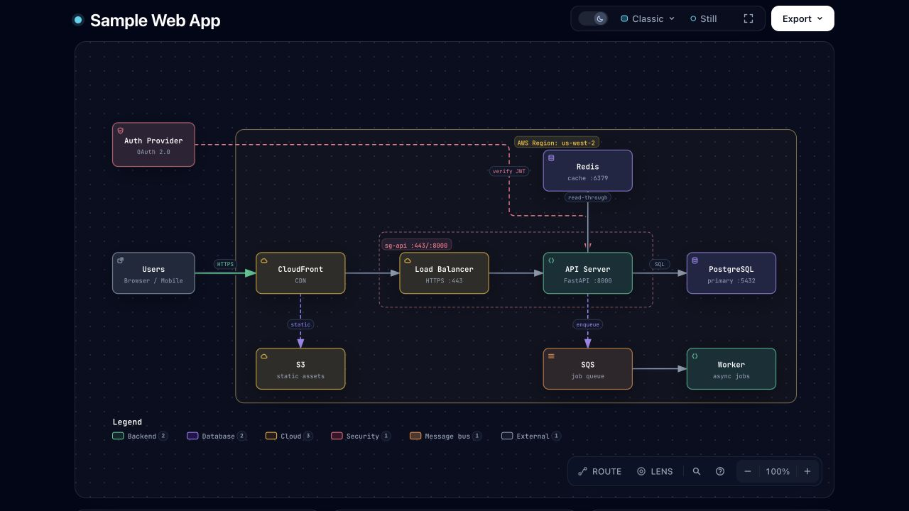

# Python Slugify explorer

A compact example of Archify's continuous repository map: 45 tracked files, 172 functions and methods, and two guided conversion walkthroughs. The core library has 7 files and 17 functions; tests account for most of the remaining declarations.

[Download the standalone explorer](python-slugify.html?raw=1) and open the downloaded HTML in a browser. GitHub's file viewer displays the source rather than running the interactive map.



Visual reference: the original Archify [Classic architecture example](https://github.com/tt-a1i/archify/blob/11b0d6031853bdae89eed57e7979aabbf0034097/archify/examples/web-app-rendered.html). The shared explorer now follows its faint enclosure outlines, restrained colored fills, subtle dot canvas, and grouped controls. Folder, file, and method colors identify ownership levels; selected connections receive stronger emphasis. Long method names wrap at readable scales, and signatures expand on demand.

<details>
<summary>Original Archify reference</summary>



</details>

Scroll to zoom from folders into files and methods. Click a method to highlight its callers and callees, or choose a guided path from **Runtime flows**.

Source: [un33k/python-slugify](https://github.com/un33k/python-slugify/tree/4b6b5b42f050f1ce96899e015247d5e3901cc433), pinned to `4b6b5b42f050f1ce96899e015247d5e3901cc433`. Embedded source retains its [MIT license](SOURCE-LICENSE.txt).

The editable index, source notes, and verification receipts are included alongside the HTML. Static analysis resolves 64 of 979 call sites; external and cross-file Python calls remain unresolved. The project was not executed.

To rebuild from the Archify repository root, with the source checkout at the pinned revision:

```sh
python3 archify/scripts/build-repository-explorer.py /path/to/python-slugify /tmp/python-slugify.html --revision 4b6b5b42f050f1ce96899e015247d5e3901cc433 --notes showcases/python-slugify/notes.json
```
